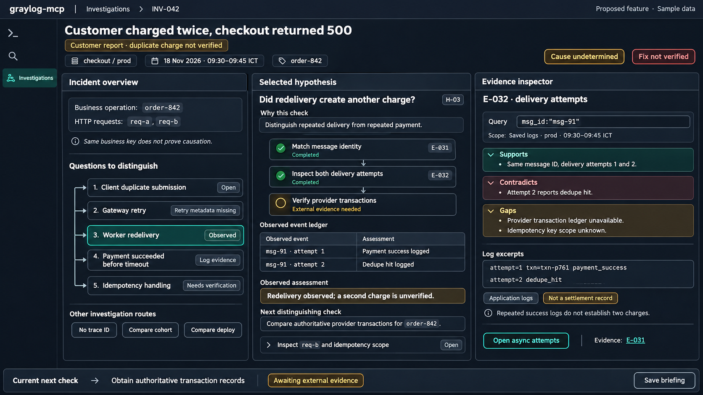
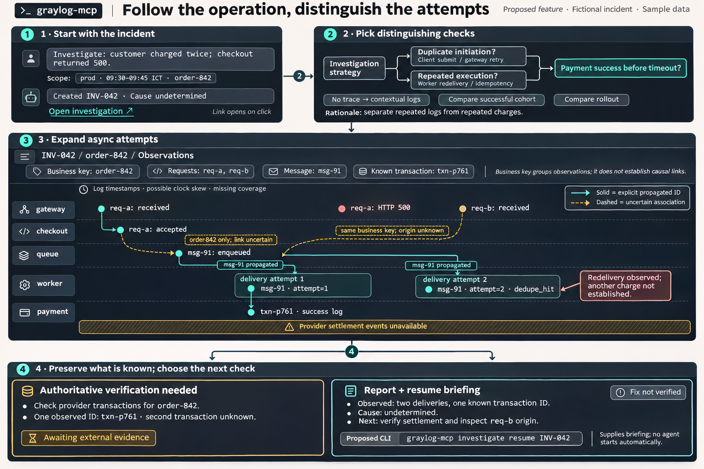

# Current investigation concept: strategy-driven branches

Status: proposed feature with fictional sample-data images. The strategy and evidence model supports complex bugs. No runtime commands or integrations are implemented.

Tracking issue: [persistent agent investigations](https://github.com/ntbang0901/graylog-mcp/issues/47). This concept PR establishes the design; the issue remains open for implementation.

## Review package

- [Feature specification](feature.md): strategy catalogue, three UI levels, branch/check records, typed identities, uncertainty, release scope, and acceptance cases.
- [Worked duplicate-charge investigation](duplicate-charge-walkthrough.md): five competing explanations, distinguishing checks, missing coverage, and authoritative verification.
- [Command and conversation playbook](command-playbook.md): how to start, steer, inspect, checkpoint, resume, and finish the investigation.
- [Underlying end-to-end lifecycle](lifecycle.md): persistence, access, local UI link, cancellation, ownership, event replay, retention, and release phases.

## Complex investigation workspace

One connected view: incident overview → selected branch → evidence inspector. The selected branch shows why a check is useful, what the results establish, and what must be checked next.

Generated with built-in imagegen. [Full workspace generation prompt](complex-workspace-image-prompt.md).

## Asynchronous attempts and end-to-end strategy

The second board connects the agent request and strategy to asynchronous observations, distinct identities and attempts, uncertain links, external verification, and a saved handoff.

Generated with built-in imagegen. [Full strategy generation prompt](async-strategy-image-prompt.md).

## Interpretation notes

- These are visual concepts. The feature specification is the implementation contract.
- The images use the richer-coverage fictional INV-042 variant described in the [walkthrough](duplicate-charge-walkthrough.md). Command examples use INV-028; both IDs are illustrative.
- A reported duplicate charge stays unverified until appropriate outcome evidence is available. Repeated processing, successful log events, and provider transactions are distinct facts.
- Explicit delivery metadata may support a redelivery subclaim. A dedupe_hit log weakens a duplicate-effect explanation but does not verify settlement or prove that all attempts were deduplicated.
- Supports and contradicts refer to precise subclaims. Neither finding automatically answers the compound question of what caused the reported business effect.
- Business keys and nearby timestamps produce candidate associations unless evidence supports a more specific relationship. Dashed or uncertain links must stay labeled.
- Async-board horizontal spacing is schematic, not a measured duration scale. The dashed req-b association is a question to investigate, not an established queue-producing request. Implemented views must show qualified queue/message namespaces even where the compact image abbreviates them.
- External verification means requesting or receiving authorized evidence with provenance. It does not imply a payment-system integration or write capability.
- UI steering remains a later acknowledged-feedback integration. Initial strategy changes happen in the agent conversation. Resume prepares context for a connected agent.

## Product direction

Ship explicit questions, strategy choices, distinguishing checks, and evidence-backed assessments as the core experience. Start with request observations and attempt lists; add richer comparison views incrementally without changing the saved evidence semantics.
