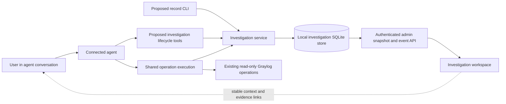

# Agent investigations: end-to-end feature concept

Status: proposed design, 18 November 2026. This document and its images do not implement new CLI commands, MCP tools, APIs, or agent integrations.

## Product decision

Turn a bug report into a durable investigation that connects the agent conversation, observable tool execution, request evidence, competing explanations, and the final handoff. Give it one stable local UI link from the start. Preserve useful work when the search fails, the request has no trace ID, or the conversation ends.

The conversation is where the user directs the agent. The workspace is where the user inspects the investigation. The CLI opens records and prepares briefings. The existing MCP server supplies Graylog operations; it does not become an independent agent runtime.

## Deliverables

- [Lifecycle command and conversation playbook](lifecycle-command-playbook.md): concrete examples for the complete workflow, with existing and proposed commands distinguished.
- [Visual concepts](README.md): a complex investigation workspace and an async strategy board, generated with fictional incident data.
- This specification: behavior, state model, architecture, delivery sequence, and acceptance criteria.

## Experience from report to handoff

| Stage | User action | Agent and server behavior | Workspace |
|---|---|---|---|
| 1. Establish scope | “Investigate checkout failures in prod, 09:30–09:45 ICT.” | Resolve the instance and date; show assumptions, and clarify material ambiguity before querying. Freeze the incident window and baseline. | A scope preview or a draft awaiting missing details. |
| 2. Create | Continue in the conversation, or supply a draft investigation ID. | Create or adopt the investigation; return its ID and UI link before slow searches. | Investigation header, incident window, repository focus, baseline, and empty plan. |
| 3. Triage | Open the link; keep talking to the agent. | Run root_cause for causal questions or scan for health checks, then verify selected findings. | Active steps appear before completion; independent checks can run side by side. |
| 4. Follow a branch | Select an error group or request. | Trace known IDs; discover IDs in error samples; otherwise inspect contextual logs without asserting request correlation. | Branch overview, request observations, evidence inspector, and coverage notes. |
| 5. Test explanations | “Compare the payment rollout with the database errors.” | Record an explicit hypothesis; collect supporting and contradicting evidence. Persist observations separately from interpretations. | Evidence-backed hypothesis comparison; unresolved alternatives remain visible. |
| 6. Recover or clarify | Correct the environment, query, time, or missing input. | Keep the failed attempt and its diagnosis. Record any scope revision and explain whether the question changed. | Recovery action, before/after query, scope-change marker, or awaiting-input state. |
| 7. Checkpoint | Conversation ends, user pauses, or server restarts. | Save completed evidence and open questions. Interrupted in-flight work is visible and does not become a successful result. | Last durable checkpoint, interrupted steps, and resume briefing. |
| 8. Resume | Ask a connected agent to continue the investigation ID. | Retrieve the briefing, validate current access and scope, acquire ownership, and continue in a new execution attempt. | Earlier evidence stays visible; a resume divider marks new work. |
| 9. Finish | Review findings or request a handoff. | Save the outcome, evidence links, limitations, and recommended checks. Analysis can finish with the cause undetermined. | A readable findings view plus full investigation history. |
| 10. Verify later | After a fix performed elsewhere, ask for a new comparison window. | Record a linked verification attempt with fresh absolute times. No deployment or code change is implied. | Original incident and verification window are compared explicitly. |

## Workspace design

### Investigation overview

The entry page lists investigations by state, instance, and last activity. Each row includes the question, incident window, current action or outcome, and whether attention is needed. Empty state offers an example prompt and instructions to start through a connected agent. It must not imply that opening the UI launches an agent.

### Investigation detail

Use one workspace with progressive disclosure rather than showing every panel at once:

- **Context header:** title, investigation ID, environment, repository focus, absolute incident window and timezone, baseline, current state. Investigation execution time is shown separately.
- **Investigation canvas:** a readable branching plan with observable steps, active checks, recovery branches, and explicit agent notes. This is a work graph; its arrows represent investigation dependencies, not application calls.
- **Evidence inspector:** the selected step's saved query and executed query, scope, counts, samples, message references, and result limitations.
- **Request view:** observations grouped by service, measured spans only where supported, stack details when available, and missing-coverage labels.
- **Hypotheses view:** supporting and contradicting evidence, last assessment, unresolved tests, and outcomes. Multiple causes can survive to the report.
- **Findings view:** concise incident narrative, impact with its denominator, evidence-backed explanations, unknowns, and verification plan.

Keep important state in words as well as color. Use slate surfaces and teal selection; amber denotes active work or missing input, coral denotes errors, and muted styling denotes unavailable coverage. A selected failed step should remain inspectable. At narrow widths, stack the canvas and inspector while preserving the selected step.

Only show request error rates when the data model identifies request events and a meaningful request denominator. Otherwise label metrics as log-event counts. Retrieved-page group counts, including those produced by optional ask flow helpers, must stay labeled as samples. Each evidence record shows its effective instance, focus, and streams because current operations differ: some searches apply repository focus while trace_request and certain root_cause views span services.

### Links and opening behavior

Return a stable `/admin/investigations/<id>` deep link for the local shared server. Determine host and port from the running service; examples must not hardcode a guaranteed port. Reuse the existing authenticated admin session or provide a deliberate sign-in flow; an investigation ID is not an access credential. Keep secrets out of investigation links.

The agent presents the link. An explicit CLI `--open` can open the browser. Reconnecting the UI or a later tool call must not repeatedly open tabs. Remote installations need a reachable authenticated deployment; a developer's local link is not a team-sharing URL.

## Cases the feature must handle

| Case | Branch and UI behavior | Honest stopping point |
|---|---|---|
| Known request ID | Search configured trace fields; use the existing full-text fallback if needed. Show the executed strategy and matches. | Explain a missing or incomplete trace; do not invent absent services. |
| Bug report without an ID | Group matching errors, inspect samples for correlation fields, and let the agent select representative requests. | If no IDs exist, show contextual logs and service-level evidence labeled uncorrelated. |
| Zero matches | Preserve the original query; show existing counted suggestions, rewrites, and clause diagnosis. | “No matching evidence in this scope” is a valid result. Wider time or scope requires an explicit revision supported by user intent. |
| No anomaly | Show checked rules and normal counts; skipped checks stay separate. | “No anomaly detected by these checks” includes what was checked and coverage gaps. |
| Several error families | Separate branches and representative requests; compare timing and scope per family. | Keep unrelated failures separate; one representative trace cannot explain all errors. |
| Competing explanations | Compare hypotheses against the same documented scope and evidence; preserve contradictions. | Finish with probable explanations or an undetermined cause when evidence is insufficient. |
| Partial, sampled, or truncated output | Distinguish total matches from returned samples. Narrow or page results when appropriate. | Coverage remains visible in both evidence and report. Exact aggregates are not the same as complete trace coverage. |
| Async boundary or clock skew | Show missing queue/consumer observations and uncertain ordering. | Log timestamps do not establish end-to-end duration or prove a call relationship. |
| Tool failure, VPN loss, timeout, or rate limit | Show the failed step and any completed sibling work. Retry with a new attempt and a bounded retry budget. | Successful empty results remain distinct from unavailable data. An unavailable required check can leave the investigation interrupted. |
| UI disconnect | Keep server-side work running; reconnect from an event cursor and current snapshot. | Lost browser connectivity does not mean the agent or Graylog query stopped. |
| Agent disconnect or server restart | Preserve completed work; expire the active execution lease and mark unfinished steps interrupted. | Resume creates a new attempt. Do not rerun old queries automatically on page load. |
| User correction | Record a new scope revision and affected steps. Keep prior evidence with its original scope. | Do not blend staging evidence into a prod conclusion or quietly overwrite time windows. |
| Two conversations | Use explicit investigation IDs and a single active mutation owner per investigation. | A second agent may read; takeover requires an explicit transfer or an expired lease. |
| User steering from the page | In a later phase, queue a directive and show pending/acknowledged/applied/declined. | The UI must not claim the agent changed its plan until the agent acknowledges it. |
| Evidence expires or config changes | Retain summaries and evidence metadata; show missing excerpts or changed access. | Never silently replace an old snapshot with a fresh search. |
| Post-fix validation | Add a linked verification attempt with a new window and baseline. | Improvement alone does not prove the original causal explanation. |

## Command and tool contract

The natural-language conversation is the primary investigation entry point. Existing setup commands remain unchanged. New CLI commands are proposed in the playbook and manage local investigation records and briefings.

Propose two MCP tools to distinguish reads from local state changes:

- `get_investigation`: retrieve a snapshot, a selected evidence record, or a compact resume briefing. No new Graylog search unless the agent explicitly calls an investigation operation.
- `investigation`: lifecycle actions `start`, `resume`, `update`, `checkpoint`, `cancel`, and `finish`. Flat arguments with action-specific validation match the current tool declaration style. New arguments and action names are proposals.

Investigation-capable Graylog tools receive an optional `investigation_id`. Propagate it through operation dispatch and nested calls. Tools used without that argument keep their existing behavior. The wrapper assigns step IDs and links results to the right attempt; callers cannot attach another repository's evidence by guessing an ID.

Lifecycle writes change local investigation state, even though Graylog remains read-only. Give the lifecycle tool accurate mutation annotations; do not inherit the current blanket read-only annotation. Apply the same policy to public Graylog tools extended with investigation recording: their declaration must allow for local mutations even when investigation_id is optional. Static tool metadata cannot change per invocation. Keep get_investigation read-only. Resolve retry semantics with operation IDs and deduplication rather than claiming every lifecycle action is naturally idempotent.

The optional existing `ask` operation can contribute evidence when configured. Core investigation persistence and the UI must work without its TypeSafe model configuration. The connected coding agent supplies the user-facing plan and assessments.

## State and data model

### Investigation state

`draft → running → awaiting_input | interrupted | completed | cancelled`.

Awaiting input and interrupted investigations can return to running through explicit resume. A completed investigation can get a linked follow-up attempt without erasing its previous report. Cancelled investigations retain their history. Browser disconnection does not itself change state.

An acknowledged checkpoint stores the briefing and moves to awaiting_input after current owned work settles. The agent stops scheduling checks before acknowledging completion of that checkpoint. Lifecycle cancel closes the attempt to new work, attempts cooperative cancellation of its running server tasks, and records any tasks that could not be stopped. A later continuation creates a new attempt. UI-delivered cancellation is a later delivery mechanism for the same lifecycle action.

Keep these concepts separate:

- **Execution state:** draft, running, awaiting_input, interrupted, completed, cancelled.
- **Analysis outcome:** explanation_supported, cause_undetermined, no_matching_evidence, no_anomaly_detected.
- **Verification:** not_requested, pending, improvement_observed, recovery_verified, inconclusive.

Completion means analysis was recorded, not that a fix was deployed or a root cause proven. A recovery verification needs documented checks and a verification window; it remains separate from causal certainty.

### Durable records

| Record | Required information |
|---|---|
| Investigation | Stable ID, title/question, canonical repository context, resolved instance, scope revisions, state, outcome, timestamps, latest revision |
| Scope revision | Absolute incident and baseline times, timezone, query/streams/focus, reason for change, author |
| Attempt | Owning client/session reference, lease and fencing token, scope revision, start/end times, checkpoint |
| Step | Operation, redacted requested and executed parameters, parent/dependencies, attempt, timestamps, state, retry-of reference |
| Evidence | Immutable ID, step/scope reference, typed summary, bounded redacted excerpts, refs, counts, sample/truncation/coverage metadata, retention state |
| Hypothesis | Explicit statement, supporting/contradicting evidence IDs, current assessment, revision history |
| Event | Investigation ID, monotonically increasing sequence, type, record IDs, timestamp, deduplication key |
| Report | Outcome, supported observations, interpretations, alternatives, limits, next checks, evidence references, verification status |

Use opaque stable IDs for storage. Human labels such as INV-024 are illustrative and can be displayed alongside an opaque key. Message refs and correlation IDs remain subject to redaction; UI routing uses the evidence ID when direct identifiers cannot be retained safely. Do not promise raw-query replay after redaction removes a required identifier: mark replay unavailable and ask for authorized input again.

## Architecture grounded in the current repository

- Introduce an investigation service and durable SQLite store distinct from the bounded `usage.jsonl` activity file.
- Instrument shared operation execution for both MCP calls and admin Playground calls. Today Playground calls operations directly, so instrumenting only `server.py` would miss that path. Normalize operation names versus public tool names when persisting steps.
- Preserve parent-child steps for composite operations. The existing root_cause call can initially be one visible step; finer progress requires explicit substep instrumentation, not invented progress percentages.
- Publish step-start events before awaiting operations. Terminal updates and evidence creation commit consistently. Persist failure and cancellation states.
- Handle asyncio.CancelledError separately from ordinary exceptions. Use bounded, shielded finalization to save a cancelled/interrupted terminal state, then re-raise cancellation. Never let the existing success default classify a cancelled call as successful. A process crash can prevent finalization; lease recovery must reconcile such steps as interrupted.
- Serve a snapshot with a matching event cursor, then authenticated fetch-based SSE with replay, deduplication, and gap detection. Existing admin auth uses a request header; native EventSource cannot supply that custom header. Handle expired cursors by resyncing from a fresh snapshot. Retain events for a documented bounded period.
- Emit stream health separately from agent lease health. The browser cannot infer agent liveness from an open SSE connection.
- Serialize lifecycle mutations with expected revisions and a single active owner lease. Use fencing tokens so a stale agent cannot keep updating after takeover. Already-issued Graylog reads may complete; associate their late results with the original attempt and do not let them replace the new report.
- Renew ownership while the server executes an owned operation, and on owner lifecycle calls or explicit agent heartbeats at safe boundaries. Apply a documented idle grace period when no tool is running. Browser or SSE heartbeats never renew agent ownership. If the client disconnects while a bounded server operation continues, let it finish and persist evidence, then apply the idle grace period; resume must not treat that work as abandoned mid-call. Timeouts and cancellation release the operation's renewal responsibility.
- Centralize redaction and result budgets before persistence, API responses, and exports. Preserve source timestamps and display timezone. Treat stored log text as untrusted content in the UI and agent briefing.
- Reuse the existing local admin authentication and host checks. Validate scope on every lifecycle call and every operation carrying an investigation ID. This is a local workspace design; repository context alone is not team access control.
- Prefer the existing shared local server for the first release. A stdio-only installation without a reachable admin service can retain records and return a briefing, but must report the UI as unavailable with setup guidance rather than returning a broken link.
- Apply retention by age and byte budget. Keep summaries and explicit expiry markers when detailed evidence is removed. Test schema migrations and recovery from interrupted writes.

## Delivery sequence

### Release 1: complete durable workflow

Ship creation, an immediate UI link, explicit scope, started/terminal steps, evidence storage, branching inspections, hypothesis updates, findings, interruption checkpoints, and agent-driven resume from a briefing. Include the proposed read/open/briefing CLI and redacted Markdown export. Handle empty search, no trace, partial results, failures, and multiple concurrent conversations in the first release.

The agent remains responsible for deciding and performing investigative checks. A CLI draft is inert until adopted by a connected agent. User steering happens in the conversation. All core functionality works without an additional model provider.

### Release 2: feedback from the workspace

Add pinning evidence, requesting a next check, and cooperative pause/cancel requests with explicit acknowledgement. Deliver through an agent polling tool or supported client integration. A directive needs an ID, author, scope, deduplication, delivery state, and an audit trail. Acknowledgement is not proof that a running query was cancelled.

### Later: team workflow

Consider shareable reports, issue tracker integration, remote hosting with deliberate authentication/authorization, and independently permissioned teammates. No external posting, deployment, or code edits are part of this feature by default.

## Acceptance checks before implementation is complete

1. A known-ID investigation returns its link before a deliberately slow query ends; the UI shows that query running.
2. A report without an ID can discover one from samples or finish with clearly labeled uncorrelated evidence.
3. Empty results preserve the original query, the recovery diagnosis, and any explicit scope changes.
4. Every reported statement points to saved evidence or is labeled an interpretation/open question.
5. Two parallel steps finish out of order without losing dependencies or duplicating events after reconnect.
6. A browser disconnect leaves the investigation running; an expired owner lease marks unfinished work interrupted.
7. Restart and resume keep the original absolute scope and completed evidence; new work appears in a new attempt.
8. Concurrent agents cannot silently overwrite the same report, and late stale results cannot mutate the active attempt's conclusions.
9. Denied queries, timeouts, zero matches, skipped checks, truncation, expired evidence, and unavailable UI have distinct states.
10. A resumed agent gets a bounded briefing with evidence references and unknowns, without an unbounded log dump or hidden external provider requirement.
11. Changed instance/repository access is validated again. Redacted identifiers do not produce a replay action that cannot work.
12. A post-fix comparison records its own time window, checks, and outcome while preserving the original incident conclusion.
13. The UI supports keyboard selection, readable status text, narrow layouts, and no automatic repeated browser opening.
14. Evidence persists through both MCP and Playground operation paths and through composite operations.
15. Core execution remains read-only toward Graylog; local state mutations have accurate tool metadata.

## Design choices to validate with users

The remaining product choices are how much branch detail to show by default, how long to retain saved evidence, and whether workspace steering is needed in the first release. These do not block reviewing the complete flow above. The visual boards explore hierarchy and alternate states; they are not proof of working integrations.
